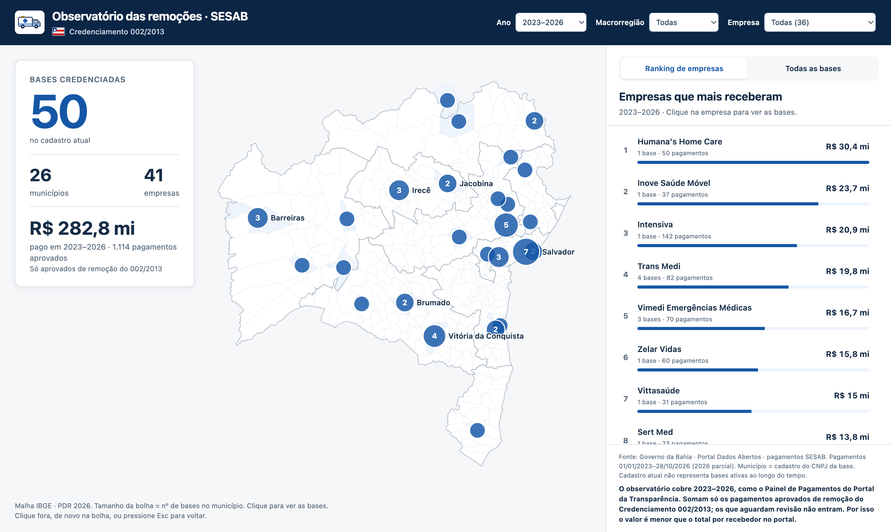

# Observatório SESAB

**Análise da distribuição geográfica de empresas credenciadas e dos pagamentos públicos relacionados ao transporte terrestre de pacientes na Bahia.**

[**Acessar dashboard interativo**](https://observatorio-sesab.pages.dev/)

[](https://observatorio-sesab.pages.dev/)

<sub>Retrato de 27 de novembro de 2026. Os números do site podem mudar a cada atualização.</sub>

## Sobre o projeto

O Observatório SESAB é um projeto independente de análise e visualização de dados públicos relacionados ao Credenciamento SESAB nº 002/2013.

O objetivo é acompanhar a evolução das empresas e bases credenciadas na Bahia, sua distribuição territorial e os pagamentos realizados pela Secretaria da Saúde do Estado da Bahia.

O projeto busca contribuir para a investigação de duas questões:

- **Distribuição territorial:** como as empresas e suas bases estão distribuídas pelo estado e como essa distribuição evoluiu?
- **Distribuição financeira:** como os pagamentos evoluíram ao longo dos anos e como os recursos estão distribuídos entre os prestadores?

A proposta é transformar informações dispersas em fontes públicas em um painel visual, interativo e de consulta rápida.

## Dashboard interativo

O painel permite explorar os dados de forma geral ou filtrada, com atualização conjunta dos indicadores, do mapa e do ranking.

**Principais funcionalidades:**

- Mapa da Bahia com as bases credenciadas por município e as macrorregiões de saúde.
- Filtros por ano, macrorregião e empresa.
- Ranking de empresas por valores recebidos.
- Lista de bases por cidade.
- Detalhe de cada base, com nome fantasia, razão social, CNPJ e data de credenciamento, quando documentada.
- Identificação das bases localizadas fora da Bahia.

A interface foi desenvolvida para priorizar a leitura imediata dos dados, com detalhamento disponível conforme o interesse do usuário.

## Dados disponíveis

O retrato publicado cobre **2023–2026**, como o Painel de Pagamentos do Portal da Transparência da Bahia, e reúne:

| Indicador | Quantidade |
|---|---:|
| Empresas cadastradas | 41 |
| Empresas com pagamento aprovado no período | 36 |
| Bases cadastradas | 50 |
| Municípios identificados | 26 |
| Pagamentos aprovados | 1.114 |
| Valor aprovado | R$ 282.758.196,74 |
| Período dos pagamentos | 2023–2026 |

*Somam somente os pagamentos aprovados na conferência; os que aguardam revisão e os excluídos ficam de fora. O valor é o de remoção do Credenciamento 002/2013, menor que o total por recebedor no portal, que não separa credenciamento. O ano de 2026 está incompleto.*

Cada base é identificada pelo CNPJ completo. As empresas são agrupadas pela raiz de oito dígitos do CNPJ, sem presumir grupo econômico ou vínculos entre pessoas jurídicas distintas. Os filtros territoriais associam pagamentos às bases somente pelo CNPJ completo.

A cópia pública contém 100 agregados de pagamentos por CNPJ e ano, correspondentes aos 1.114 pagamentos aprovados.

## Fontes de dados

O Observatório utiliza informações de fontes oficiais, incluindo:

- [Portal de Dados Abertos do Estado da Bahia](https://dados.ba.gov.br/dataset/pagamentos) — registros financeiros do FIPLAN.
- Diário Oficial do Estado da Bahia (DOOL/EGBA) — atos e termos relacionados aos credenciamentos. O acervo e as evidências de conferência não integram este repositório.
- Secretaria da Saúde do Estado da Bahia (PDR 2026) — informações territoriais e regionalização da saúde.
- Instituto Brasileiro de Geografia e Estatística (IBGE) — dados e malhas geográficas. As malhas derivadas publicadas estão separadas dos dados financeiros.

A versão atual utiliza uma cópia dos dados financeiros obtida em 6 de novembro de 2026, com pagamentos de janeiro de 2023 a 28 de outubro de 2026.

Os pagamentos são apresentados pelo ano de efetivação, independentemente do período em que o serviço foi realizado.

## Tecnologias

| Camada | Tecnologias |
|---|---|
| Interface | React, TypeScript e Vite |
| Visualização geográfica | SVG com malhas do IBGE |
| Tratamento e exportação | Python |
| Armazenamento no ambiente de desenvolvimento | PostgreSQL |
| Publicação | Cloudflare Pages |
| Desenvolvimento | Engenharia de software assistida por IA |

A versão pública é estática. Um exportador Python copia campos permitidos e agrega pagamentos por CNPJ e ano, com conferência da soma em centavos. O navegador calcula os filtros sobre esse JSON, sem acesso direto ao PostgreSQL ou à aplicação administrativa.

## Executando localmente

Requisitos: Node.js e npm.

Na pasta `web`:

```bash
npm ci
npm run test:publico
npm run build:publico
npx vite preview --config vite.publico.config.ts
```

A versão pública poderá ser acessada em:

`http://127.0.0.1:4180/`

Os arquivos em `web/publico/estatico` são uma cópia agregada fixa, incluída para reprodução sem banco ou credenciais. Use os comandos acima: os demais scripts de `web/package.json` pertencem ao ambiente local completo.

Para conferir a saída, a partir da raiz, com Python:

```bash
python3 scripts/publico/guarda_publico.py web/dist-publico
```

Para desenvolver o exportador, `uv sync` instala o ambiente Python registrado em `pyproject.toml` e `uv.lock`. A exportação de uma nova cópia exige um snapshot privado de pagamentos aprovados, que não é distribuído. O teste de paridade Python/TypeScript depende de arquivos externos e é pulado quando eles não são fornecidos; os testes sintéticos não precisam desses arquivos.

O ambiente administrativo, a API administrativa, as migrações, o pipeline histórico, os backups e os arquivos históricos de trabalho não integram esta publicação.

## Metodologia e limitações

O Observatório realiza análise estatística de dados públicos. Não constitui auditoria financeira individual nem ferramenta oficial da SESAB.

Algumas considerações relevantes:

- Os totais representam somente pagamentos aprovados conforme critérios de associação ao credenciamento. Pagamentos que aguardam revisão e excluídos não entram.
- O mapa utiliza o município cadastral das bases, não os locais individuais de realização dos atendimentos, e não demonstra cobertura assistencial.
- O cadastro de bases é o atual e depende das datas documentais disponíveis; não representa necessariamente as empresas em atividade em cada ano.
- Os valores são nominais, sem atualização monetária.
- A disponibilidade de registros pode variar entre períodos. Ausência de pagamento aprovado não demonstra ausência de serviço.
- A relação entre crescimento de empresas e evolução dos pagamentos permite investigar tendências, mas não estabelece causalidade automaticamente.

## Próximas evoluções

O projeto permanece em desenvolvimento, com melhorias previstas para:

- Consultas individualizadas por CNPJ completo.
- Ampliação e atualização das séries históricas.
- Refinamento da classificação dos pagamentos.
- Melhorias de visualização e interação.
- Acompanhamento da distribuição territorial e financeira ao longo do tempo.

## Código e transparência

Este repositório disponibiliza uma seleção revisada do código da versão pública: interface, agregação em Python e TypeScript, exportação, guarda do pacote e testes.

Os dados operacionais, credenciais, arquivos privados e componentes administrativos são mantidos fora do repositório. O versionamento usa uma lista explícita de arquivos e bloqueia novos arquivos por padrão.

Consulte a [documentação técnica complementar](docs/README.md), a [política de publicação](docs/SEGURANCA.md) e o [inventário dos arquivos publicados](docs/INVENTARIO_PUBLICAVEL.tsv).

Para conferir a seleção de arquivos, a partir da raiz:

```bash
python3 scripts/publico/conferir_repositorio.py
```

---

**Projeto independente, sem vínculo institucional com o Governo do Estado da Bahia ou com a SESAB.**

Desenvolvido por Lucas Piau.

[**Explorar o Observatório SESAB**](https://observatorio-sesab.pages.dev/)
